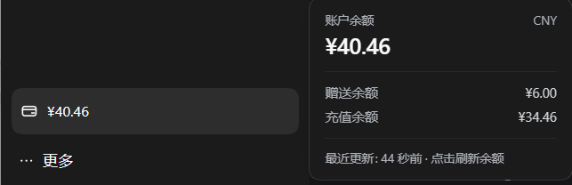

# dsh-balance-display

DeepSeek Harness（DSH）的 Web 插件，提供两处读数：

1. **账户余额** —— 侧边栏底部的方框，样式与设置入口一致。
2. **本会话费用** —— 输入框下方 dock 里的第 4 个 pill，与 DSH 自己的 token 用量读数并排。

## 账户余额

方框位于 `sidebar.footer.action` 槽位，ui-sidebar 把这一槽位渲染在 `sidebar.settings` 区之上。位置由**外壳结构**决定，不是靠 CSS 硬凑，所以侧边栏或设置面板怎么改都不会让它错位。

默认**每分钟**刷新一次，**点击方框立即刷新**。悬停（或键盘聚焦）会打开**明细卡**，显示金额、赠送/充值拆分，以及数据的新鲜度。

卡片的底色取自**左侧边栏自身的表面**。


鼠标悬停时：



## 会话费用

输入框下方的 dock 本来就有三个读数 —— ui-chat 的计时 pill、token 用量 pill，以及 ContextMeter。本插件加上**第 4 个 pill**，显示本会话累计费用：


它注册在 `conversation.composer.dock` 上（与那三个读数同一个列表槽位），order 大于 ui-chat 自己的 `stats` 条目，因此落在 token pill 右侧。样式照抄同排 pill 的几何：`1px/8px` 内边距、`24px` 圆角、静止时背景透明、13px 三级文字、14px 图标、等宽数字 —— 于是它是这一排里的平等一员，而不是贴在邻居身上的补丁。

它**刻意是 `span` 而不是 `button`**：没有任何东西可以打开，所以不声明 hover 底色。静止状态下它与旁边的按钮完全一致，只有鼠标反馈不同 —— 而那个反馈在这里会是假话。

### 费用怎么算

**token 总量取自 DSH 的 `tokenUsage` 投影** —— 也就是紧邻的 token pill 打印的那个完整数字 —— 所以钱数不可能和旁边的 token 数自相矛盾：

```
total = ( uncachedInput × 未命中价
        + cacheRead     × 命中价
        + cacheWrite    × 命中价    ← 无单独的写入价；DeepSeek 的缓存写入按命中价计
        + output        × 输出价 ) / 1,000,000
```

四个桶互斥，不会重复计费；reasoning token 已经含在 `outputTokens` 里。

**峰谷权重取自每轮的 Chat 节点。** 投影没有时间戳，所以每个已完成的 `turn-tail` 节点把自己的 token 数计入**峰时占比**：会话中有多大比例的 token 跑在峰时段窗口内。因为峰价恰好是谷价的 2 倍，加权可以收敛成一个乘数：

```
cost = (1 + 峰时占比) × 按谷价算的总价
```

没跨过时段边界的会话是精确计价；跨过的按比例计价。完全拿不到轮次时间的会话**整体按谷价**，而不是按当前钟点 —— 数字不应该在没有新用量时自己变动。

轮次节点取自 **Chat 节点仓库**（`useChat(state => state.nodes.values())`），而不是 `state.legacy.nodes`。这个区分同样是承重的：ui-chat 的 `legacyContribution` 对 `turn-tail` 行**故意**返回空贡献（「这些已知的 Chat 行有意不参与 legacy 时间线」），所以那个兼容切片永远不含它们，读它一个轮次时间都找不到。测试双向钉住了这一点。万一数据源形状再次变动，组件会在 console 里说一次，而不是默默沉默。

内置单价是 **DeepSeek 官方 2026 年 9 月价** —— 元 / 百万 tokens：

| 档位 | 缓存命中 | 缓存未命中 | 输出 |
|---|---|---|---|
| 谷价 | 0.02 | 1 | 4 |
| 峰价 | 0.04 | 2 | 8 |

峰价恰好是谷价的 2 倍。**峰时段为 UTC 01:00–04:00 与 06:00–10:00**（即北京时间 09:00–12:00、14:00–18:00）。按北京日历的**周末全天为谷价**，该规则优先于时段窗口。当前所有官方模型共用这套价，所以一张表同时服务 `deepseek-flash` 与 `deepseek-v4-pro`。

金额显示两位小数；不足一分的会话保留四位，以免塌成一个 `0.00`。

### 显示设置

| 字段 | 默认 | 含义 |
|---|---|---|
| 显示会话费用 | 开 | 是否渲染该 pill。 |
| 费用单位 | `yuan` | 印在金额后面的文字，中间隔一个空格。 |
| 区分峰谷价 | 开 | 按每一轮实际发生的时间套用峰价或谷价。关闭后全部按谷价。 |
| 谷价 · 缓存命中 / 未命中 / 输出 | *内置* | 谷价单价，元 / 百万 tokens。留空用内置价；峰价按 2 倍推导。 |

这些全部存在**本浏览器的 `localStorage`**（键名 `dsh-balance-display`）—— 见[配置模型](#配置模型)。

如果 DeepSeek 调价，或者你是通过条款不同的转售方计费，可以在这里覆盖单价。中途切换过模型的会话会整体按所配置的费率计价 —— 轮次数据虽然带路由信息，但只套用一套价。

## 安装

插件就是一个普通目录，下载后复制路径即可使用 `dsh` 插件管理功能进行安装。

或者使用命令行：

```
dsh plugin --profile web add github:PoinTSHine/dsh-balance-display
```

## 配置模型

设置由每个插件条目自己的 `Config` schema 派生，经 `settings.describe()` 暴露，存放在 profile 补丁里。

本包**不声明 `Config`**，这是硬约束而不是偏好：不引入真正的 schemastery 库就产不出合法的 `Config`。

DSH 用 `new Schema(json)` 复原 schema（见 dsh-settings 里的 `plainSchema`）。该构造函数**只通过**真正的 `toJSON()` 产出的 `{ uid, refs }` 信封来解析子节点引用 —— 而普通的 `{ type, meta, dict }` 描述会被 `Object.assign` 原样拷入，`dict` 里的子节点仍是普通对象，不会变成 schema。只有 builder（`z.object(...)` 之类）才会把子节点交给 `Schema.from`，而 `Schema.from` **对普通对象直接抛错**（`cannot infer schema from [object Object]`）。所以手写的替身必须伪造一张真正的引用表。真库是公开发布的，但对于从 DSH 安装树之外以绝对路径加载的插件，它无法被解析，除非连同它自己的依赖一起 vendoring 进来。

于是设置按**谁真正拥有它**拆分：

| 设置 | 存放位置 | 原因 |
|---|---|---|
| 接口地址、凭据名、超时 | 上面加载行的 `config:` 段 | 只有服务端半使用它们 |
| 显示哪些读数、刷新间隔、币种、金额单位、峰谷、单价覆盖 | 本浏览器的 `localStorage` | 纯属浏览器半的显示偏好 |

设置页能编辑的全部属于第二行，所以**完全不需要 DSH 的设置服务**它也能工作。页面里的**数据来源**区块是只读的：它报告服务端半实际解析出了什么。

## 余额从哪来

`GET {endpoint}/user/balance`，带 `Authorization: Bearer <API key>` —— DeepSeek 官方的余额接口（[API 文档][balance-docs]）。它返回：

```json
{
  "is_available": true,
  "balance_infos": [
    { "currency": "CNY", "total_balance": "110.00",
      "granted_balance": "10.00", "topped_up_balance": "100.00" }
  ]
}
```

[balance-docs]: https://api-docs.deepseek.com/api/get-user-balance

## 设置页

位于**设置 → 余额显示**。

| 字段 | 默认 | 含义 |
|---|---|---|
| 显示余额框 | 开 | 是否渲染侧边栏方框。 |
| 自动刷新间隔 | 60 秒 | 轮询间隔，10–3600 秒。无论如何，点击方框总会刷新。 |
| 显示币种 | *自动* | 显示哪一条 `balance_infos`，例如 `CNY`。留空即自动挑选。 |
| 接口地址 | *继承* | 接口根地址。 |
| API Key 变量名 | *继承* | 凭据**名称** |
| 请求超时 | 10 000 毫秒 | 单次请求超时，1000–60000 毫秒。 |

页面能编辑的所有内容都存在本浏览器的 `localStorage`；接口地址、凭据名与超时在这里是只读的，它们来自插件的加载配置。

### 显示规则

- provider 返回多种币种时的顺序是不稳定的，所以方框不会简单取第一条。它优先取**真正有钱**的币种，其次 CNY，最后才取第一条 —— 这能阻止数字在币种之间随机跳变。
- `is_available: false`（余额不足）会把方框和卡片页脚染成警示色，并写明 `余额不足`，让这个颜色有理由。
- 缺少凭据会明确写出来（`未配置`），因为它可操作；其它失败一律显示 `—`，由卡片承载 provider 自己的报错原文。
- 卡片在悬停**和**键盘聚焦（`:focus-visible`）时打开。鼠标点击不会把它钉住 —— 否则点一次刷新后它会一直挂着，直到你点别处。`Escape` 关闭它。

## 安全

- **API Key 不进浏览器。** 只有服务端半与 provider 通信，它暴露的路由只返回金额和凭据**名称**，绝不返回密钥。有测试断言密钥不可能出现在响应体里。
- **密钥不会经明文发送。** `https:` 地址始终允许；`http:` 仅允许本机回环（本地代理）。其它情况 —— 远程 `http:` 主机、畸形 URL、`file:`/`ftp:` 协议 —— 都在**构造请求之前**就被拒绝。
- **不依赖任何凭据文件的私有格式。** 插件按名称向 `credentials` 服务索取，从不解析 `~/.dsh/.credentials.yaml`。


## 目录结构

```
balance-display/
├── index.js          服务端半：设置归一化 + /_dsh/balance-display/state
├── client.js         浏览器半：侧边栏方框 + 轮询 runtime + 费用 pill + 设置页
├── cordis.patch.yml  挂载服务端行的 bundle 补丁
├── package.json      dsh.bundle / dsh.client 元数据
├── pics/             截图（被两份 README 引用）
├── test/
│   ├── verify.mjs    服务端半检查
│   └── client.mjs    浏览器半检查
└── readme.md         readme
```


## 许可证

MIT
